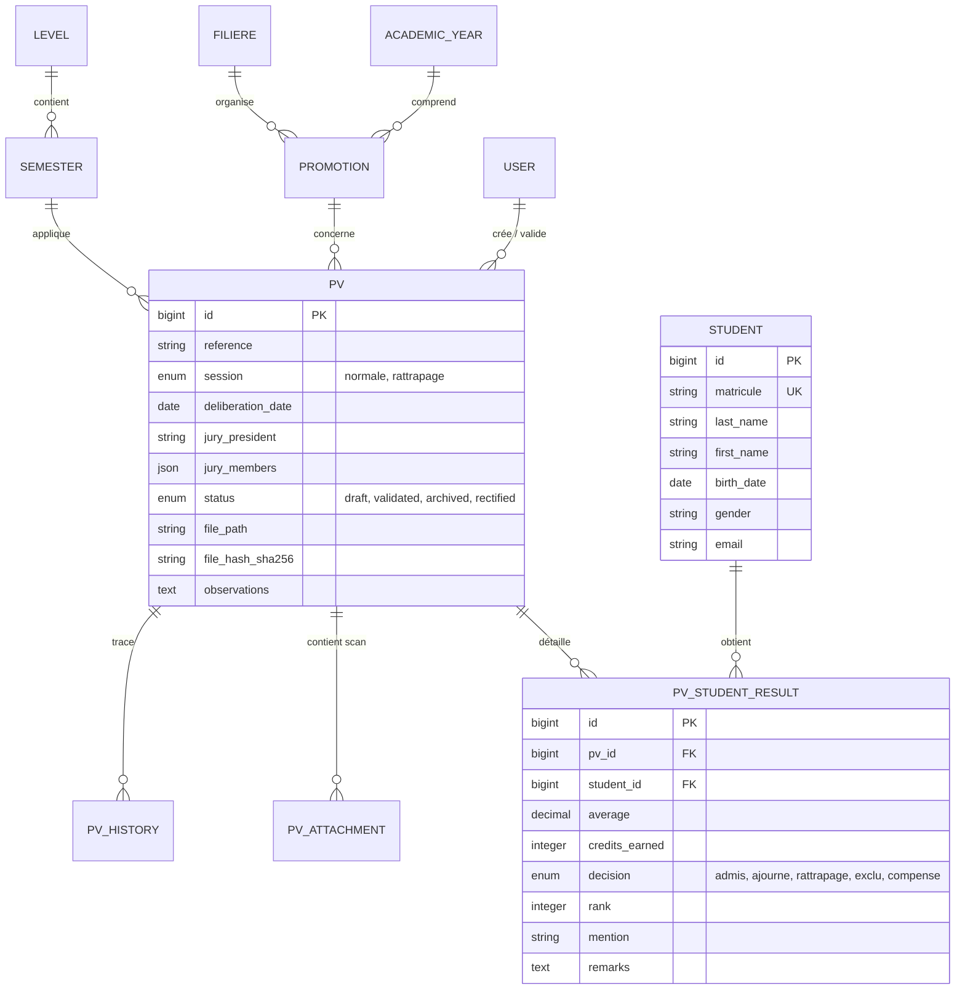

# Dossier de Conception & Spécifications : Gestion et Recherche des PV de Délibération (ENEAM)

Ce document constitue le guide de référence complet pour la conception, la modélisation et le développement de l'application web de gestion et de recherche des procès-verbaux (PV) de délibération de l'**École Nationale d'Économie Appliquée et de Management (ENEAM - UAC)**.

---

## 1. Contexte & Enjeux Métier

### 1.1 Contexte Universitaire (Système LMD à l'ENEAM)
L'ENEAM applique le système **LMD (Licence - Master - Doctorat)** :
- **Filières** : Informatique de Gestion (IG), Statistique et Économétrie, Banque et Finance, Gestion des Ressources Humaines (GRH), Marketing, Comptabilité & Audit, etc.
- **Niveaux d'études** :
  - Licence : L1 (Semestres S1 & S2), L2 (Semestres S3 & S4), L3 (Semestres S5 & S6).
  - Master : M1 (Semestres S1 & S2), M2 (Semestres S3 & S4).
- **Sessions d'examen** : Session Normale (Principale) et Session de Rattrapage.
- **Décisions de jury types** : Admis(e), Ajourné(e), Admis(e) avec compensation, Autorisé(e) à composer en rattrapage, Exclu(e).

### 1.2 Problématique actuelle
1. **Perte de temps** : Retrouver manuellement un PV papier vieux de 5 ou 10 ans dans les archives physiques prend des heures, voire des jours.
2. **Détérioration du papier** : Risque d'usure, de moisissure ou de sinistre (incendie, dégât des eaux).
3. **Recherche étudiante complexe** : Vérifier si un étudiant spécifique a validé son semestre nécessite d'ouvrir physiquement plusieurs cartons d'archives.
4. **Sécurité et intégrité** : Nécessité d'assurer qu'aucun PV numérisé ne soit falsifié après coup.

---

## 2. Matrice des Rôles et Permissions (RBAC)

| Rôle | Description | Droits clés |
| :--- | :--- | :--- |
| **Administrateur Système** | Service informatique ENEAM | Gestion des utilisateurs, référentiels, configuration, sauvegarde, audit logs complets. |
| **Agent de Scolarité / Examens** | Opérateur de saisie et d'archivage | Numérisation, téléversement de PV, saisie manuelle / import Excel des résultats, édition brouillon. |
| **Chef de Département / Directeur des Études** | Autorité académique | Validation formelle des PV, consultation étendue, génération de statistiques de département. |
| **Enseignant** | Corps professoral | Consultation en lecture seule des PV de son département / filière. |
| **Consultant Externe / Vérificateur** (Optionnel) | Entreprise ou université partenaire | Vérification d'un extrait de PV via URL signée / QR Code. |

---

## 3. Modèle de Données (MCD / MLD)

### 3.1 Entités Principales

### 3.2 Dictionnaire des tables SQL recommandées

1. **`academic_years`** : `id`, `code` (ex: "2023-2024"), `start_date`, `end_date`, `is_current`.
2. **`filieres`** : `id`, `code` (ex: "IG"), `name` ("Informatique de Gestion"), `department`.
3. **`levels`** : `id`, `code` (ex: "L1", "L2", "L3", "M1", "M2"), `cycle` ("Licence", "Master").
4. **`semesters`** : `id`, `level_id`, `code` (ex: "S1", "S2"), `name`.
5. **`promotions`** : `id`, `academic_year_id`, `filiere_id`, `level_id`.
6. **`students`** : `id`, `matricule` (Unique), `last_name`, `first_name`, `gender`, `birth_date`, `phone`, `email`.
7. **`pvs`** :
   - `id`, `promotion_id`, `semester_id`, `reference` (ex: `PV-2024-IG-L2-S3-NORM`),
   - `session` (`normale`, `rattrapage`),
   - `deliberation_date`, `jury_president`, `jury_members` (JSON array),
   - `file_path`, `file_hash_sha256` (empreinte cryptographique),
   - `status` (`draft`, `validated`, `archived`, `rectified`),
   - `parent_pv_id` (auto-référence pour les PV rectificatifs/additifs),
   - `created_by`, `validated_by`, `validated_at`.
8. **`pv_student_results`** :
   - `id`, `pv_id`, `student_id`, `average` (note/20), `credits_earned`, `decision`, `rank`, `mention`.
9. **`activity_logs`** :
   - Traçabilité complète (qui a consulté, téléchargé, modifié ou validé quel PV à quelle heure et depuis quelle IP).

---

## 4. Propositions Innovantes & Points Forts (Différenciation pour la note)

Pour que votre projet obtienne la note maximale auprès du jury et du professeur, voici **5 fonctionnalités innovantes à forte valeur ajoutée** :

### 🌟 Point 1 : Intégrité Cryptographique & Scellement (SHA-256)
- Lors de l'upload du scan PDF/image, le système calcule le hash `SHA-256` du fichier brut et le stocke en base.
- Un bouton « **Vérifier l'intégrité du document** » recalcule le hash en temps réel et certifie qu'aucun fichier n'a été altéré ou substitué sur le disque.

### 🌟 Point 2 : Filigrane Dynamique Anti-Fuite (Watermarking à la volée)
- Un PV de délibération contient des données personnelles sensibles.
- Lors de l'affichage du scan PDF ou de son téléchargement, le système incruste un filigrane translucide dynamique :
  `"Document consulté par [Nom Utilisateur] le [Date et Heure] - ENEAM Archivage"`.
- Cela dissuade les fuites non autorisées sur les réseaux sociaux.

### 🌟 Point 3 : Gestion des "PV Additifs / Rectificatifs" (Versioning académique)
- Dans la vraie vie universitaire, des réclamations de notes aboutissent souvent à un PV rectificatif.
- Le système ne doit **jamais effacer** l'ancien PV. Il lie le nouveau PV au précédent (`parent_pv_id`), marque l'ancien comme `rectifié` et affiche l'historique complet avec le motif de rectification.

### 🌟 Point 4 : Matrice de Complétude des Archives ("Heatmap" des PV manquants)
- Un tableau de bord visuel (grille dynamique : Lignes = Filières, Colonnes = Semestres) avec des pastilles de couleur :
  - 🟢 **Vert** : PV normal + rattrapage validés et archivés.
  - 🟡 **Jaune** : En attente de validation ou session rattrapage manquante.
  - 🔴 **Rouge** : PV manquant (alerte pour la scolarité).
- Export immédiat du rapport des promotions sans PV pour le conseil d'établissement.

### 🌟 Point 5 : Extrait Numérique Sécurisé avec QR Code de Vérification
- Possibilité pour la scolarité de générer un « **Extrait officiel de délibération** » pour un étudiant en un clic (PDF synthétique).
- Le document dispose d'un **QR Code contenant un lien signé sécurisé (`URL::temporarySignedRoute`)**.
- En scannant le QR code avec un smartphone, un employeur ou une autre université peut certifier l'authenticité de la délibération sans avoir accès aux notes des autres étudiants de la promotion.

---

## 5. Architecture Technique Recommandée

- **Backend** : Laravel 11 / 12 (PHP 8.4)
- **Base de données** : MySQL / MariaDB (support des index composites et JSON)
- **Interface Utilisateur (UI)** :
  - Soit **Blade + Tailwind CSS + Alpine.js** (approche légère, rapide et robuste pour les projets universitaires).
  - Soit **Filament PHP 3** (kit d'administration complet avec tables dynamiques, filtres multi-critères, dashboards et permissions intégrés).
- **Packages Laravel clés** :
  - `spatie/laravel-permission` : Gestion dynamique des rôles et autorisations.
  - `maatwebsite/excel` : Importation en masse des listes d'étudiants et export des PV.
  - `spatie/laravel-activitylog` : Journalisation d'audit immutable.
  - `barryvdh/laravel-dompdf` : Génération des extraits et rapports en PDF.
  - `simplesoftwareio/simple-qrcode` : Génération de QR Codes vectoriels.

---

## 6. Guide de Collaboration Git & GitHub pour le Groupe

### 6.1 Organisation des Branches
- `main` : Branche stable de production (ne jamais commiter directement dessus).
- `develop` : Branche principale de développement où l'on fusionne les fonctionnalités terminées.
- `feature/<nom-fonctionnalite>` : Branches créées par chaque membre pour une tâche précise (ex: `feature/import-excel-etudiants`, `feature/recherche-multicritere`).

### 6.2 Cycle de travail recommandé
1. Récupérer les dernières modifications : `git checkout develop && git pull origin develop`
2. Créer sa branche : `git checkout -b feature/ma-tache`
3. Faire des commits atomiques avec des messages clairs.
4. Ouvrir une **Pull Request (PR)** sur GitHub vers `develop` pour relecture par un camarade.
